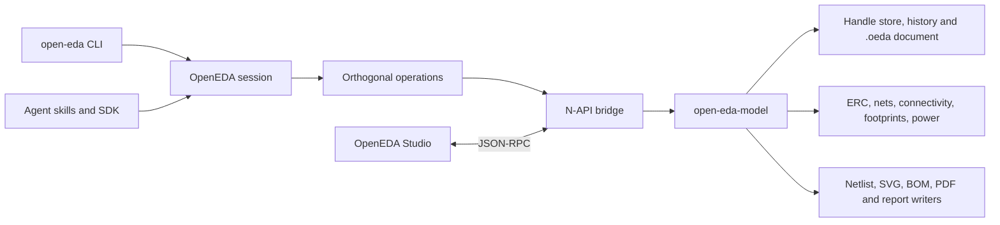

# OpenEDA

[](https://github.com/nyar-os/OpenEDA)
[](https://github.com/nyar-os/OpenEDA)
[](https://github.com/nyar-os/OpenEDA)

One editable schematic document behind capture, inspection, netlist/SPICE/SVG/BOM/PDF
handoff and agent authoring.

OpenEDA is a desktop studio and command line for electronic designs. A project
is a single `.oeda` document: schematic sheets, components, nets and wires stay
in one revisioned model instead of being scattered across a folder of exchange
files.

## Status

The schematic document core works. The native model creates, edits, saves and
reopens one `.oeda` document, runs ERC, net, connectivity, footprint and power
checks, and writes netlist, SPICE, SVG, BOM, PDF, Markdown report and JSON
document projections. It also exports and imports the same schematic subset as a KiCad
6/7 schematic (`kicad_sch`): symbols, wires, junctions, no-connect flags, text
annotations and net labels, including global and hierarchical labels. Editing
covers components, nets (derive, disconnect, delete), design-level buses
(declare, list, remove), wires, junctions and text (move and delete by index),
sheet add/rename/delete, and undo/redo. The SDK and studio keep a bounded
32-step history per open handle. A session created with `history: 'sidecar'`
additionally records each replaced document in `<file>.history.json`, which is
how the CLI makes undo/redo work across separate invocations. All entry points
exercise the same model, so no one reports a different capability.

The board engine and the interactive renderer are not implemented. DRC,
clearance, KiCad board and Gerber exchange, drill output, footprint assignment
and routing all report `capability/not-implemented`. `open-eda capabilities`
prints exactly which entries are supported.

| Capability | Status | Notes |
| --- | --- | --- |
| `.oeda` create/open/save/edit | supported | sheets, components, nets, buses, wires, junctions, text, undo/redo |
| checks `erc`, `nets`, `connectivity`, `footprints`, `power` | supported | `drc` and `clearance` are unsupported |
| export `net`, `spice`, `svg`, `bom`, `bom_json`, `pdf`, `report`, `json`, `kicad_sch` | supported | read-only projections; `kicad_pcb` and `gbr` are unsupported |
| import `kicad_sch` | supported | symbols, wires, junctions, no-connect flags, text and labels; other constructs are reported as loss entries |
| KiCad board, Gerber, drill, STEP | unsupported | declared in the capability matrix only |
| interactive schematic/board renderer | unsupported | the preview is an SVG projection |

The KiCad importer is deliberately narrow. Buses, hierarchical sheets, arcs,
images and every other construct outside that subset are not dropped silently:
each occurrence adds a `{"code": "kicad/unsupported-element", "detail": "..."}`
entry to the import losses. Global and hierarchical labels are imported as
sheet-local net labels and each occurrence adds a
`{"code": "kicad/label-scope", "detail": "..."}` entry, because the document
does not model cross-sheet label scope. Junctions, no-connect flags and text
annotations are part of the subset and round-trip without a loss entry.

ERC keeps the inspection codes stable: `erc/duplicate-pin` reports a component
that declares one pin name twice, `erc/dangling-net` reports a declared net with
no nodes, and `erc/duplicate-net-name`, `erc/single-node-net`,
`erc/unconnected-pin` and `erc/floating-wire` report the remaining findings.
`erc/reference-illegal`, `erc/pin-name-illegal` and `erc/net-name-illegal` reject
names that would break the `REF.PIN` node or `NET` line grammar the netlist and
SPICE writers emit, so an illegal name fails inspection instead of producing an
ambiguous file. The `nets` check reports `net-bus-member-collision` when a
declared net has the same name as a member the bus expansion would write, so the
netlist never emits one `NET` line twice.

A bus is a design-level declaration, not a drawn bus wire. A bus named `DATA`
with width 4 expands into the member nets `DATA0`..`DATA3` (name plus the 0-based
index, no separator). A declared net with the bus name repeats its nodes into
every member; a bus without such a net still lists its members, without nodes.

The `connectivity` report is the read-only companion of the connectivity check:
it lists every net with its node count and `REF.PIN` pin list, the pins no net
reaches, and the per-sheet wire-group and junction totals, tagged
`open-eda-connectivity` and deterministic for one revision.

The SPICE writer projects the schematic to a deterministic `.cir` netlist.
Elements follow their reference prefix (`R`/`C`/`L` two-pin, `D` two-pin with a
model, `Q`/`J` three-pin, `V`/`I` sources, `U`/`X` subcircuit calls, unknown
prefixes as generic `X` elements). A pin without a net becomes a stable
`NC_<ref>_<pin>` node and is reported with `spice/open-pin`, so it is never
dropped silently.

Undo history is never written into the `.oeda` document. A session created with
`history: 'sidecar'` keeps it beside the document in `<file>.history.json`;
`save()` to a new target clears the stale sidecar on that target, and creating a
document again starts a fresh history.

## Usage

The SDK is the API. Every operation is a method on the session or on the
`Design` it returns:

```ts
import { OpenEDA } from '@wae/open-eda';

const eda = new OpenEDA({ history: 'sidecar' });
const design = await eda.create({ title: 'Blinker' });

await design.addComponent({ reference: 'R1', value: '10k', x: 40, y: 30, pins: ['1', '2'] });
await design.setFootprint({ reference: 'R1', footprint: 'Resistor_SMD:R_0805_2012Metric' });
await design.connectNet({ net: 'VCC', nodes: ['R1.1'] });
await design.addJunction({ x: 55, y: 30 });
await design.addText({ text: 'Revision A', x: 20, y: 12 });
await design.addWire({ net: 'VCC', from: [40, 30], to: [70, 30] });
await design.addBus({ name: 'DATA', width: 4 });
const buses = await design.listBuses();

await design.save({ target: 'blinker.oeda', overwrite: true });
await design.export({ format: 'kicad_sch', target: 'blinker.kicad_sch' });
await design.export({ format: 'spice', target: 'blinker.cir' });

const imported = await eda.importKicadSch({ source: 'blinker.kicad_sch', target: 'imported.oeda' });
await eda.dispose();
```

`history: 'sidecar'` is opt-in. The default, `history: 'memory'`, keeps only the
native per-handle stack; the module that touches `node:fs` is loaded lazily and
only for file-backed work. The CLI below is a thin shell over this same session
and enables the sidecar so `undo`/`redo` survive invocations.

```bash
# Print the capability matrix (net, spice, svg, bom, pdf, report, json export; erc/nets/connectivity/footprints/power supported)
open-eda capabilities

# Create a native design document
open-eda create --out blinker.oeda --title "Blinker"

# Add two components to the existing document, in place
open-eda component add blinker.oeda --ref R1 --value 10k --x 40 --y 30 --pins 1,2
open-eda component add blinker.oeda --ref C1 --value 100n --x 70 --y 30 --pins 1,2
open-eda component footprint blinker.oeda --ref R1 --footprint Resistor_SMD:R_0805_2012Metric

# Connect pins to a net, then edit the objects
open-eda net connect blinker.oeda --net VCC --nodes R1.1,C1.1
open-eda net disconnect blinker.oeda --net VCC --nodes C1.1
open-eda net derive blinker.oeda
open-eda net rename blinker.oeda --id VCC --name VIN
open-eda net delete blinker.oeda --net VIN
open-eda bus add blinker.oeda --name DATA --width 4
open-eda bus list blinker.oeda
open-eda bus remove blinker.oeda --id DATA
open-eda component move blinker.oeda --ref R1 --x 50 --y 30 --rotation 90
open-eda component update blinker.oeda --ref R1 --value 22k

# Add and use another sheet
open-eda sheet add blinker.oeda --name Power
open-eda sheet rename blinker.oeda --id sheet-2 --name Main

# Add, move and delete a junction or a text annotation in place
open-eda junction add blinker.oeda --x 55 --y 30
open-eda junction move blinker.oeda --index 0 --x 60 --y 30
open-eda junction delete blinker.oeda --index 0
open-eda text add blinker.oeda --text "Revision A" --x 20 --y 12
open-eda text move blinker.oeda --index 0 --x 24 --y 14
open-eda text delete blinker.oeda --index 0

# Undo or redo the newest edit, then save in place
open-eda undo blinker.oeda
open-eda redo blinker.oeda

# Run the supported checks and list objects
open-eda inspect blinker.oeda --checks erc,nets,connectivity,footprints,power
open-eda list blinker.oeda
open-eda symbols blinker.oeda
open-eda connectivity blinker.oeda

# Export supported projections
open-eda export blinker.oeda --format net --out blinker.net
open-eda export blinker.oeda --format spice --out blinker.cir
open-eda export blinker.oeda --format svg --out blinker.svg
open-eda export blinker.oeda --format bom --out blinker.csv
open-eda export blinker.oeda --format bom_json --out blinker-bom.json
open-eda export blinker.oeda --format pdf --out blinker.pdf
open-eda export blinker.oeda --format report --out blinker.md
open-eda export blinker.oeda --format json --out blinker.json
open-eda export blinker.oeda --format kicad_sch --out blinker.kicad_sch

# Import a KiCad schematic into a native document
open-eda import blinker.kicad_sch --out blinker-imported.oeda

# Open the studio window
open-eda gui
```

A native document is UTF-8 JSON with the tag `open-eda-design` and version `1`.
The netlist writer emits `# OpenEDA netlist v1`, then `BUS <name> <width>` for
every declared bus, then `NET <name>` followed by `NODE <ref>.<pin>` lines. The
SPICE writer emits `* OpenEDA SPICE netlist v1`,
one element line per component, `NC_<ref>_<pin>` nodes for open pins, and
`.END`. The SVG writer draws a frame, wires, junctions, text annotations and
component boxes with reference and value labels. The BOM writer groups
components by value and footprint and emits
`Comment,Footprint,Designator,Quantity` with sorted designators compressed into
inclusive ranges (`R5-R7` for three or more consecutive numbers); `bom_json`
writes the same rows as a deterministic `open-eda-bom` projection. The PDF writer
emits a complete one-page A4 landscape vector document (`%PDF-1.4` header,
cross-reference table, `%%EOF`) with sheet names, component boxes and wires.
The report writer emits deterministic Markdown with a design header, a
per-sheet object-count table, one `Net | Nodes | Pins` table per sheet and an
inspection section grouped by severity.
The `symbols` report groups placed components by the library id the KiCad writer
derives from their pins and lists the pin count, references, assigned footprints
and missing footprint count per symbol.
The JSON writer emits a deterministic, read-only document projection tagged
`open-eda-projection` with the design header and, per sheet, its components,
nets, wires, junctions and text annotations; internal allocation counters are
not part of it.
The KiCad writer emits a KiCad 6/7 S-expression with a `lib_symbols` section,
one symbol per component, one `wire` per segment, one `junction` per connection
dot, one `text` per annotation and one `label` per net;
identifiers are derived from the document ids, so the same design always writes
byte-identical output.
Every file is written through a temporary file and a rename.

Because a CLI invocation is its own process, its `history: 'sidecar'` session
records the document it is about to replace in `<file>.history.json` before
saving. `undo` and `redo` swap the newest snapshot between the two stacks, bump
the restored revision relative to the current file, reopen the document, and
preserve up to 32 steps. Deleting the sidecar, or creating the document again,
starts a fresh history; a direction with no snapshot fails with `history/empty`.

## Architecture



The TypeScript layer owns the session API, argument parsing, help text and exit
codes. `cli.ts` is a thin shell: it parses options, calls session or `Design`
methods, prints the result and returns an exit code. The native bridge maps
values only; it never grows a second design model. The studio is a static UI
served by the desktop window and talks to the same operations over JSON-RPC.

## What it does NOT do

- It does not import or write KiCad boards, Gerber or STEP files, and it does
  not simulate a design: the SPICE projection is a netlist export only.
- It imports and writes only the schematic subset it models: components, wires,
  junctions, no-connect flags, text annotations and net labels. Buses, hierarchy
  and arcs are reported as import losses instead of being reconstructed; global
  and hierarchical labels are flattened to sheet-local nets and reported as
  `kicad/label-scope`.
- It models buses as design-level name and width declarations. It does not draw
  bus wires or infer bus membership from schematic geometry.
- It does not draw an interactive schematic or board, route, or check clearance.
- It does not assign footprints: it stores the footprint text you set, and the
  BOM and KiCad writer emit it verbatim, but it never picks, validates or
  places a footprint. It does not run DRC or clearance checks.
- Connectivity and power checks analyse the schematic's wires and nets only;
  they do not model a board, copper or current flow.
- It does not store undo history in the `.oeda` document itself; the optional
  sidecar is separate and is not carried with the design.
- It does not ship fabricated previews, sample boards or placeholder reports.
- It does not claim a format is supported because an extension is known.

Classification is not a support claim. A format may be listed in the registry
while remaining `unsupported` in the capability matrix.

## Repository layout

```text
projects/
├── packages/
│   ├── open-eda            # CLI, SDK and native bridge
│   ├── open-eda-ui         # OpenEDA Studio window
│   ├── open-eda-skills     # agent skills package
│   ├── open-eda-win32-x64  # native addon, Windows x64
│   ├── open-eda-darwin-x64 # native addon, macOS x64
│   ├── open-eda-darwin-arm64
│   ├── open-eda-linux-x64
│   └── open-eda-linux-arm64
└── sites/
    └── homepage            # product site
```

## License

Mozilla Public License 2.0. See [License.md](License.md).
