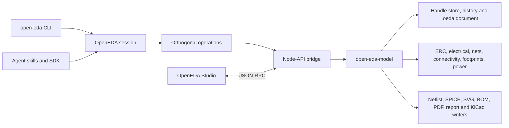

# Architecture

Maintainer reference for how OpenEDA is put together. The user-facing landing
page is the repository [README](../README.md); the npm registry page is the
[`@wae/open-eda` package README](../projects/packages/open-eda/README.md).

## Shape of the product

A design is one `.oeda` UTF-8 JSON document with the tag `open-eda-design` and
version `1`. The same document is the CLI's unit of work, the SDK's session
state and the studio's backing file.



## Module boundaries

| Layer | Location | Responsibility |
|-------|----------|----------------|
| Model | `projects/crates/eda-model` | Document shape, validation, edits, checks, diff, statistics and every writer/reader |
| Node-API | `projects/crates/eda-napi` | Maps one operation per export onto the model and returns JSON |
| SDK | `projects/packages/open-eda/src` | Session and `Design` handles, argument and error mapping |
| CLI | `projects/packages/open-eda/src/cli.ts` | Option parsing, help text, printing and exit codes only |
| Studio | `projects/packages/open-eda-ui` | Static UI served by the desktop window, talks JSON-RPC |
| Skill | `projects/packages/open-eda-skills` | Agent instructions that must match the installed CLI/SDK |

The Rust model is the only implementation. The Node-API layer maps values and
prefixes error codes; it never adds domain rules, defaults that change results,
or caching. The TypeScript layer does not duplicate schematic logic: the CLI is
assembly only and the SDK forwards to the same operations.

## Session and history

A session creates a process-wide handle. Editing calls mutate the design,
increment the revision and return the changed object.

- `history: 'memory'` (default) keeps a bounded 32-step stack inside the native
  handle. Opening a file starts a fresh history.
- `history: 'sidecar'` additionally records each replaced document in
  `<file>.history.json`. This is how the CLI makes `undo`/`redo` work across
  separate invocations. A session that saves to a new target clears the stale
  sidecar on that target.

Undo history is never written into the `.oeda` document itself.

## Determinism

The same document and the same command produce byte-identical output on every
machine:

- identifiers in KiCad output derive from the document id and object id;
- BOM rows are grouped and designators compressed in a fixed order;
- reports and Markdown/HTML contain no timestamps;
- `diff` ignores node order and the internal edit counter, and compares modelled
  objects rather than bytes.

## Errors and exit codes

Every failure carries a stable code. The CLI maps its own argument errors to
exit code `2`, `capability/*` to `2`, and other failures to `1`. An unsupported
operation is never approximated silently.

## Workspace layout

```text
projects/
├── crates/
│   ├── eda-model/      # native model, checks, readers and writers
│   └── eda-napi/       # Node-API bridge
├── packages/
│   ├── open-eda        # CLI, SDK and native bridge
│   ├── open-eda-ui     # OpenEDA Studio window
│   ├── open-eda-skills # agent skills package
│   └── open-eda-<platform>-<arch> # staged native addons
└── sites/
    └── homepage        # product site
```

Tests live in `projects/crates/eda-model/tests/unit/` (private-model tests,
included with `#[path]`) and `projects/packages/open-eda/tests/` (TypeScript
smoke tests). Production sources never contain test modules.
